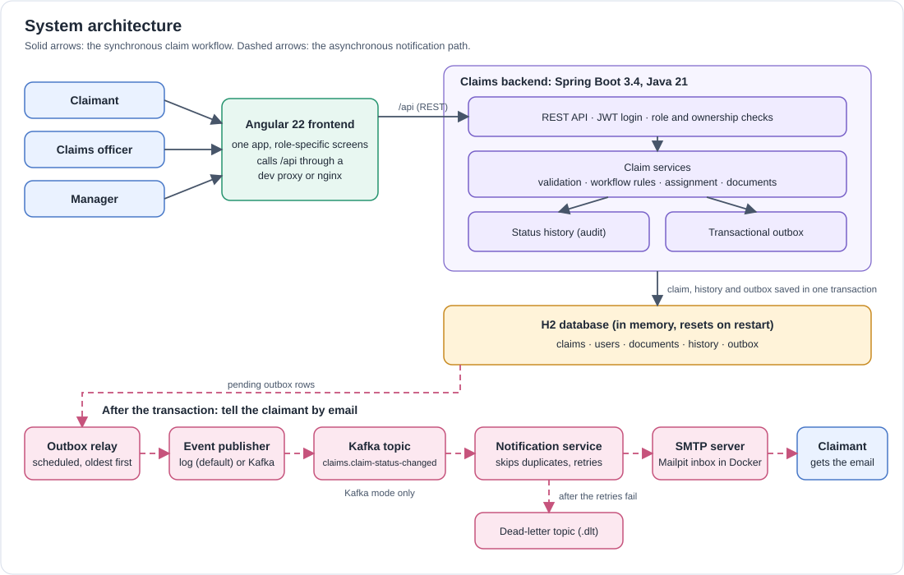
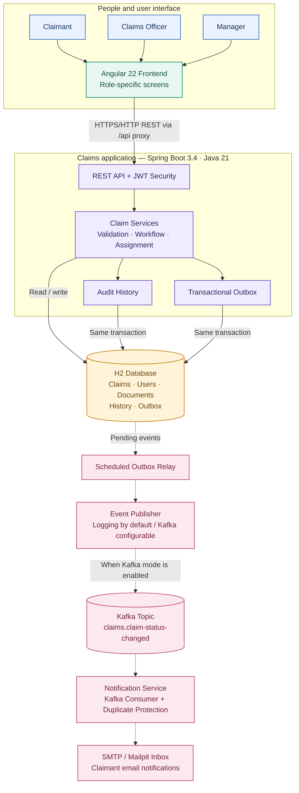
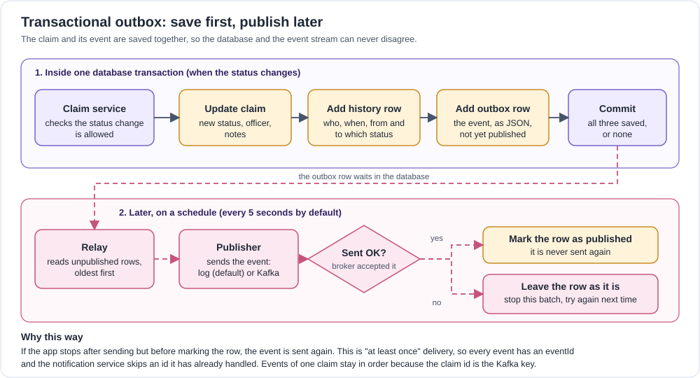
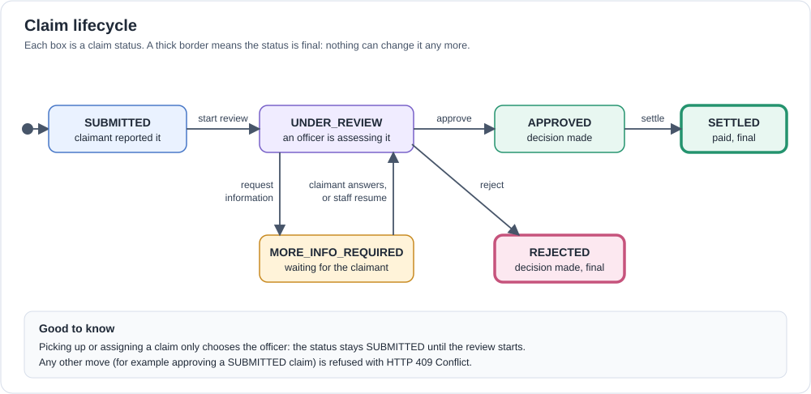

# Claims Management Platform — Architecture

> **Document status:** describes the current repository implementation and separates verified behaviour from intended or future behaviour. Review this document whenever code, configuration, or integration contracts change.

## Contents

- [1. System context](#1-system-context)
- [2. Architecture principles and decisions](#2-architecture-principles-and-decisions)
- [3. Application components](#3-application-components)
- [4. Backend design](#4-backend-design)
- [5. Domain model](#5-domain-model)
- [6. Claim lifecycle](#6-claim-lifecycle)
- [7. Synchronous API and asynchronous events](#7-synchronous-api-and-asynchronous-events)
- [8. Security and authorization](#8-security-and-authorization)
- [9. Frontend design](#9-frontend-design)
- [10. Integration contracts](#10-integration-contracts)
- [11. Testing and verification](#11-testing-and-verification)
- [12. Limitations and evolution plan](#12-limitations-and-evolution-plan)

## 1. System context

The platform supports claim submission, assessment, decisions, settlement, supporting documents, operational dashboards, and email notifications. It is delivered as one repository containing three independently runnable applications.



### At a glance: how the platform works

The diagram below is designed for a quick client walkthrough. **Solid arrows** show the synchronous claim workflow; **dashed arrows** show the asynchronous notification path.



**Client explanation:** Users work through the Angular screens. The Spring Boot API authenticates the user and applies claim rules. Claim changes, audit history, and an outbox event are saved together in one database transaction. The relay then publishes the event asynchronously; when Kafka mode is enabled, the notification service consumes it and sends the email. H2 is currently in-memory, so its data resets when the backend restarts.


### 1.1 Applications and ownership

| Component | Technology | Responsibility | Authority |
|---|---|---|---|
| `frontend/` | Angular 22, TypeScript, RxJS, signals | Screens, navigation, role-specific workflows, API calls | Presentation only; backend decisions are authoritative |
| `backend/` | Java 21, Spring Boot 3.4.5, Spring Security, JPA, H2 | API contract, claim rules, access control, persistence, audit history, outbox | Source of truth for claims |
| `notification-service/` | Java 21, Spring Boot, Spring Kafka, Spring Mail | Consume status-change events and email claimants | Does not own claims or call the claims API |
| Kafka | Event broker when configured | Carry status-change events to consumers | Transport, not business authority |
| Mailpit / SMTP | Local SMTP and inbox in the Compose configuration | Capture or deliver notification email according to configuration | External delivery boundary |

### 1.2 Request and event paths

**Synchronous request:** browser → Angular application → `/api` proxy → Spring Boot API → service/business rules → repository → H2.

**Asynchronous notification:** status change → outbox row in the same transaction → scheduled relay → configured event publisher → Kafka → notification service → SMTP inbox.

The frontend development server proxies `/api` to port `8080`. The Docker configuration uses nginx as the corresponding same-origin proxy. This avoids cross-origin browser calls in the current setup; the backend itself has no CORS configuration.

### 1.3 Runtime and validation status

| Item | Current state |
|---|---|
| Backend and frontend local development | Run using the commands in `README.md` |
| H2 persistence | In-memory; all data resets on backend restart |
| Kafka publisher | Default is logging; Kafka can be enabled by configuration |
| Notification integration | Backend, notification service, Kafka broker, and SMTP server were run together outside Docker on 2026-10-26 |
| Docker Compose | Configuration exists; the available record does not establish a successful full Compose run |
| Production readiness | Not claimed; see [Section 12](#12-limitations-and-evolution-plan) |

## 2. Architecture principles and decisions

| Decision | Choice | Rationale | Revisit when |
|---|---|---|---|
| Claims backend shape | Layered modular monolith | Claim, history, assignment and outbox must be consistent; one deployable API is simpler to develop and operate for the current scope | Different capabilities need independent release or scaling |
| API interaction | REST for commands and queries | Callers need immediate validation and a definitive HTTP result | A separate asynchronous command contract becomes necessary |
| Status events | Transactional outbox and relay | Prevents the database commit and event publication from silently disagreeing | Multiple backend instances require relay coordination or row locking |
| Notification delivery | Separate consumer service | Email latency or failure should not block claim updates | Additional channels or preferences need their own persistence |
| Database | In-memory H2 | Keeps the project runnable without an external database service | Persistent data, operational recovery, or concurrent deployment is required |
| Market | Validated two-letter code | The application does not own a fixed master list of markets | Market-specific rules, currencies, or reference data are required |
| Frontend | One Angular app with role-specific areas | All roles share the claim domain and API; a separate frontend deployment is not currently justified | Separate teams need independent release cycles |
| File storage | Document bytes in the database | Keeps files inside the claim access model without a separate storage service | File volume, scanning, retention, or size requirements increase |

## 3. Application components

### 3.1 Repository layout

```text
.
├── backend/                 Spring Boot REST API and business rules
├── frontend/                Angular single-page application
├── notification-service/    Kafka consumer and email delivery
├── docs/                    Validation guides and architecture diagrams
├── docker-compose.yml       Intended local container topology
├── DOCKER.md                Container setup and validation guide
├── README.md                Entry point and local run instructions
├── ARCHITECTURE.md           System design and trade-offs
├── AI_JOURNAL.md             AI assistance and verification record
└── CLAUDE.md                 Repository-level contributor guidance
```

### 3.2 Backend layers



| Layer | Responsibility |
|---|---|
| Security and configuration | JWT authentication, password hashing, security rules, application settings |
| Controllers | HTTP contract, request/response mapping, authorization annotations, status codes |
| Services | Transactions, validation of business rules, state transitions, assignment, audit recording |
| Repositories | Spring Data JPA persistence and aggregate queries |
| Entities | Users, claims, history, documents, and outbox events |
| Event publishing | Scheduled relay and configured logging or Kafka publisher |

Package areas under `com.claims` include `controller`, `service`, `repository`, `entity`, `dto`, `mapper`, `security`, `config`, `exception`, `validation`, `util`, and `event`.

## 4. Backend design

### 4.1 API and transaction boundaries

Controllers expose the REST contract. Services enforce business rules and own transactional operations. Repositories persist the state. A claim status transition records the updated claim, an audit-history row, and an outbox event within the same database transaction.

### 4.2 Error handling

Errors use RFC 7807-style `application/problem+json` responses. Invalid workflow transitions return `409 Conflict`; authentication and authorization failures return `401` and `403` where appropriate. Claims that a user is not permitted to view return `404` to avoid disclosing their existence.

### 4.3 Claim documents

Claimants may attach up to five files to an open claim, with a 5 MB limit per file. Accepted formats are PDF, JPG, and PNG. The backend determines file type from the file content rather than trusting the filename or browser-provided content type. Documents are stored in the H2 database and are lost on restart.

## 5. Domain model

| Entity | Responsibility and key attributes |
|---|---|
| `User` | Email, password hash, full name, role (`CLAIMANT`, `OFFICER`, `MANAGER`) |
| `Claim` | Claim/policy numbers, claimant details, incident date, description, amount, claim type, market, status, claimant, assigned officer, information request/response, decision notes, timestamps |
| `ClaimStatusHistory` | Append-only transition record: claim, previous and next status, actor, note, timestamp |
| `ClaimDocument` | File metadata, content, uploader, upload timestamp, and associated claim |
| `OutboxEvent` | Aggregate identity, event type, JSON payload, creation time, publication time |

Relationships: a claimant may own multiple claims; a claim may have an assigned officer, multiple status-history records, and multiple supporting documents. Outbox events reference the claim aggregate by type and ID.

`claimType` is `MOTOR` or `PROPERTY`. `market` is a validated two-letter code, not an enum, because the platform does not own a definitive market list.

## 6. Claim lifecycle



| Current status | Allowed next status | Actor/action |
|---|---|---|
| `SUBMITTED` | `UNDER_REVIEW` | Assigned officer or manager starts review |
| `UNDER_REVIEW` | `MORE_INFO_REQUIRED` | Officer/manager requests information |
| `MORE_INFO_REQUIRED` | `UNDER_REVIEW` | Claimant provides information or staff resumes review |
| `UNDER_REVIEW` | `APPROVED` | Officer/manager approves |
| `UNDER_REVIEW` | `REJECTED` | Officer/manager rejects |
| `APPROVED` | `SETTLED` | Officer/manager settles |
| `REJECTED` | None | Terminal state |
| `SETTLED` | None | Terminal state |

An unsupported transition returns `409 Conflict`. Pickup and assignment set the responsible officer but do not change the claim status; the claim remains `SUBMITTED` until review begins.

## 7. Synchronous API and asynchronous events

### 7.1 Interaction model

| Operation | Mechanism | Reason |
|---|---|---|
| Submit, read, list, queue, pickup, assign | Synchronous REST | The caller needs a direct result |
| Review, request information, provide information, approve, reject, settle | Synchronous REST command | The backend must validate the current status and authorization |
| Notify consumers that status changed | Asynchronous event | Notification delivery must not block a claim update |
| Manager dashboards | REST queries | Current implementation computes aggregates from the database |

### 7.2 Transactional outbox sequence

1. The service validates the transition.
2. In one database transaction, it updates the claim and inserts both a history row and an outbox event.
3. A scheduled relay reads unpublished events oldest-first and calls the configured publisher.
4. After successful publication, the relay marks the row as published. On failure, it leaves the event for retry and stops that batch to preserve order.

### 7.3 Delivery semantics

- **At-least-once:** a process failure between broker acknowledgement and marking the row published can result in a repeated event.
- **Duplicate protection:** events carry an `eventId`; consumers use it to avoid sending duplicate notifications.
- **Per-claim ordering:** the claim ID is used as the Kafka record key.
- **Default mode:** the logging publisher allows local use without a broker.
- **Kafka mode:** set `app.events.publisher=kafka` (or `EVENTS_PUBLISHER=kafka`) and configure `spring.kafka.bootstrap-servers`.

The event topic defaults to `claims.claim-status-changed`. The event contains claim identifiers, type, market, amount, old/new status, actor, timestamp, and claimant name/email for notification delivery. Because claimant contact details are present in the event, Kafka access and retention should be restricted.

### 7.4 Notification service

The notification service consumes status-change events and sends claimant emails. The recorded implementation includes retries, a dead-letter topic, duplicate protection, and a local Mailpit inbox in the Docker configuration. The service has no claims database and does not call the claims API.

## 8. Security and authorization

- JWT bearer authentication; password hashes use BCrypt.
- Role checks and claim ownership checks are enforced by the backend, including method-level security.
- The UI's role guards and hidden buttons are usability features, not security boundaries.
- Public authentication endpoints are registration and login. Public registration creates claimant accounts only.
- Swagger/OpenAPI is available for local API exploration.
- The H2 console is disabled by default. When enabled for local development, it does not require an application token and must not be exposed in a shared environment.
- Seeded staff accounts are local-demo credentials only. Production deployment requires secure secret handling, account provisioning, and security review.

## 9. Frontend design

The frontend is a single Angular 22 application with standalone components, lazy-loaded role areas, signals for local screen state, RxJS for asynchronous API operations, and a shared API service. It provides claimant, officer, and manager workflows in one interface.

The frontend calls relative `/api` URLs through the development proxy or the nginx proxy configured for Docker. Backend response codes remain authoritative; the UI maps known errors into user-facing messages.

The report form provides a six-market selection, a seven-day incident-date window, and a generated policy number. These are UI conventions; the API itself accepts any valid two-letter market code, any past incident date, and a policy number within its API length limit.

## 10. Integration contracts

### 10.1 API contract ownership

The backend owns endpoint paths, request/response models, validation, authorization, and error semantics. Every endpoint should be documented in OpenAPI, and changes to the contract should be accompanied by backend tests, frontend model/service changes, and documentation updates.

### 10.2 Same-origin proxy

The backend has no CORS configuration. Local development uses `frontend/proxy.conf.json` to route `/api` to port `8080`; the Docker topology uses nginx for the same purpose. If the frontend is hosted on a different origin, CORS or an equivalent gateway arrangement will be needed.

### 10.3 Validation rules

At submission, the API requires the claimant email to match the authenticated account, a description of at least 20 characters, a positive amount with at most two decimal places, a non-future incident date, a two-letter market code, and a supported claim type. The UI adds narrower choices for the incident date, market list, and generated policy number.

### 10.4 Assignment and decision notes

Assignment and pickup determine who is responsible for a claim; review and decision actions control the lifecycle. Status history is append-only and records who made a transition and the associated note where applicable.

## 11. Testing and verification

The following are the latest verification results recorded in the project documents on **2026-10-26**. They are historical evidence, not a guarantee that a later checkout remains unchanged.

| Area | Recorded result | Notes |
|---|---|---|
| Backend | 118 tests passed; 97.1% line coverage; 86.9% branch coverage | Maven tests and JaCoCo |
| Notification service | 76 tests passed | Tests start Kafka and SMTP infrastructure in the JVM |
| Frontend | 312 tests passed; strict production build passed | Vitest and Angular build |
| Integrated services | Backend, notification service, Kafka broker, and SMTP server run together outside Docker | Recorded on 2026-10-26 |
| Browser checks | Redesigned screens and document upload manually checked at desktop and phone widths | Real file chooser and drag-and-drop were not exercised |
| Docker Compose | Not verified in the available development record | Must be built and tested in the target environment |

Re-run the commands in `README.md` before presenting current test counts as freshly verified.

## 12. Limitations and evolution plan

| Current limitation | Recommended next step | Why |
|---|---|---|
| H2 is in-memory and resets on restart | PostgreSQL plus Flyway migrations | Durable data and repeatable schema changes |
| Docker Compose execution is unverified | Build and exercise the full stack in a clean environment | Verify configuration, health, networking, Kafka and email flow |
| No browser-level automated end-to-end suite | Add a small stable E2E suite | Catch integration and rendering defects beyond unit tests |
| No optimistic locking | Add a version column and conflict handling | Protect concurrent edits to the same claim |
| Documents are stored in database rows | Consider object storage, malware scanning, and retention policies | Scale and govern file handling |
| Event payload includes claimant contact details | Apply least-privilege topic access and retention controls | Reduce exposure of personal data |
| Demo credentials and local security settings | Externalize secrets and complete production security review | Safe deployment beyond local assessment |
| Dashboards query the operational database | Consider a dedicated read model only if measured load justifies it | Separate reporting load from claim writes |

## Appendix A. Useful local endpoints

| Endpoint | Purpose |
|---|---|
| `http://localhost:4200` | Frontend |
| `http://localhost:8080/swagger-ui/index.html` | Swagger UI |
| `http://localhost:8080/v3/api-docs` | OpenAPI JSON |
| `http://localhost:8080/h2-console` | H2 console; disabled by default |

## Appendix B. Related documents

- [README](README.md)
- [AI Working Journal](AI_JOURNAL.md)
- [Repository contributor guide](CLAUDE.md)
- [Docker guide](DOCKER.md)
- [End-to-end validation flow](docs/E2E-VALIDATION-FLOW.txt)
- [Swagger test guide](docs/SWAGGER-TEST-GUIDE.txt)
