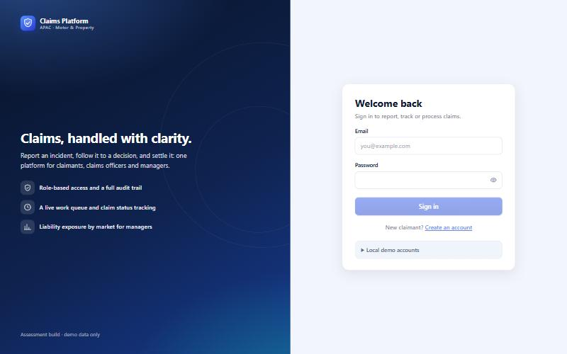
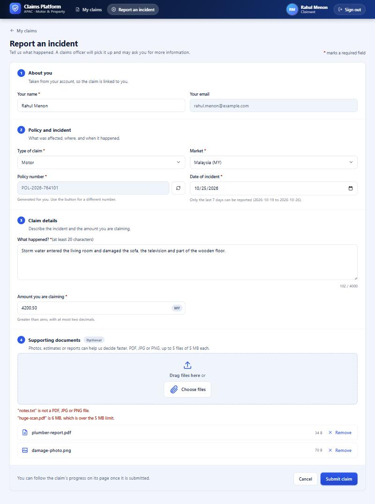
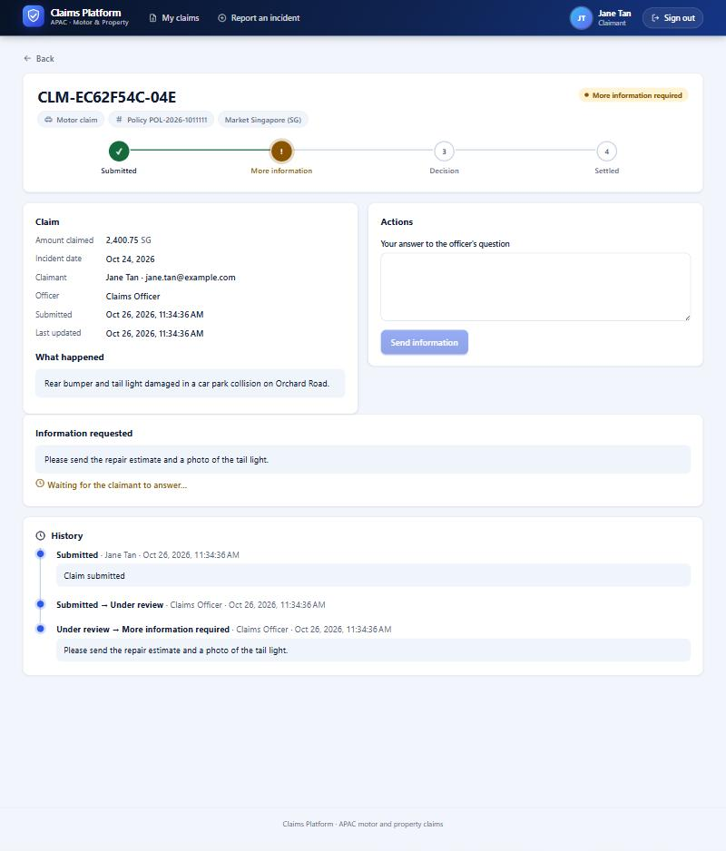
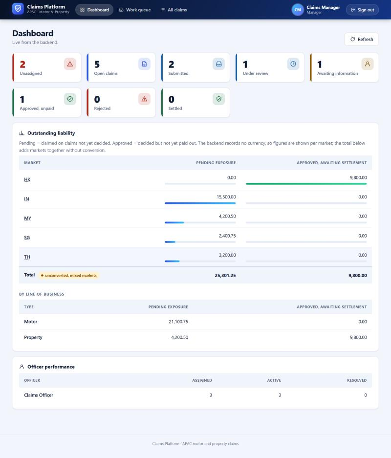
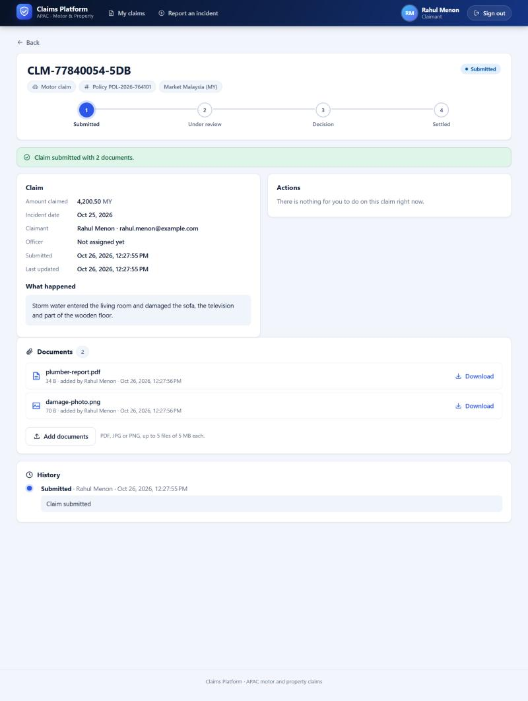
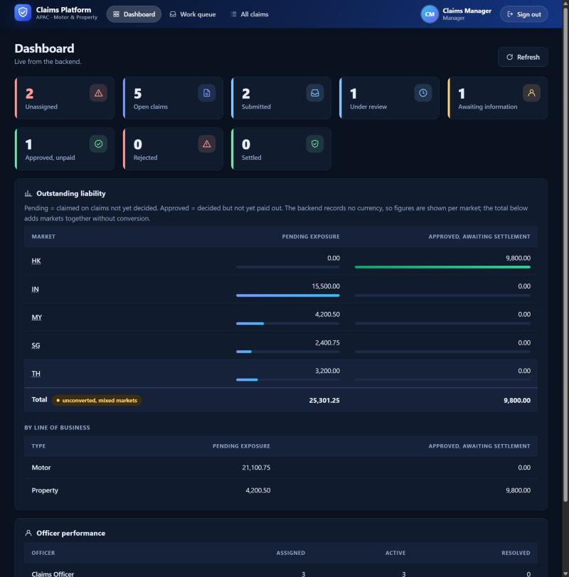

<div align="center">

# Claims Management Platform

**APAC Motor & Property Claims · Explicit Workflows · Traceable Decisions**

A full-stack claims management application built with **Java, Spring Boot, and Angular** for claim submission, assessment, decision tracking, and management reporting.

[](https://openjdk.org/)
[](https://spring.io/projects/spring-boot)
[](https://angular.dev/)
[](https://www.h2database.com/)
[](https://kafka.apache.org/)
[](https://www.docker.com/)

[Quick Start](#quick-start--run-it-locally) · [Build & Test](#build-and-test) · [API Guide](#api-overview) · [Architecture](ARCHITECTURE.md) · [AI Journal](AI_JOURNAL.md) · [Docker Guide](DOCKER.md)

</div>

---

## What this solves

A small full-stack claims platform that replaces scattered claim tracking with **role-specific workflows, controlled status transitions, and an auditable history**. The backend is authoritative for business rules and access control; the Angular frontend provides the user experience for each role.

| Role | What they can do |
|---|---|
| **Claimant** | Register, submit incidents (optionally with photos, estimates or reports attached), track claims and history, respond to information requests, add documents, read decisions, and **get an email each time their claim changes status** |
| **Claims officer** | Work the oldest-first queue, pick up or review claims, read and download the claimant's documents, request information, approve or reject claims, and mark approved claims as settled |
| **Manager** | View all claims and their documents, assign claims to officers, and review workload, liability by market/type, and officer performance |

## The application

| | |
|---|---|
|  |  |
| **Sign in.** Brand panel, show/hide password, demo accounts for local use. | **Report an incident.** Market chosen from a list of six, incident date limited to the last 7 days, policy number generated, optional supporting documents (a refused file is listed with its reason). A missing or invalid required field gets its own message and an error summary. |
|  |  |
| **Claim page.** Progress through the stages, facts, actions for your role, and the full history. | **Manager dashboard.** Workload tiles, liability per market, officer performance. Dark mode follows the operating system (below). |
|  |  |
| **Documents.** Everyone who can see a claim can download its documents; the claimant who owns it can add more while it is open. | **Dark mode.** Follows the operating system. |

## Technology stack

| Area | Technologies |
|---|---|
| Backend | Java 21, Spring Boot 3.4, Spring MVC, Spring Security with JWT, Spring Data JPA, Bean Validation |
| Frontend | Angular 22, standalone components, signals, zoneless change detection; a hand-built design system (light and dark themes, responsive layout, SVG logo and icons, no UI library) |
| Persistence | In-memory H2 (the only database in use; data resets on restart). PostgreSQL is only a commented datasource example: no driver is included |
| Events | Transactional outbox with log publisher by default and optional Kafka publisher |
| Notifications | A separate **notification service** (Spring Boot, Spring Kafka, Spring Mail) that consumes the status-change events and emails the claimant; retries, a dead-letter topic and duplicate protection; Mailpit as the local inbox in Docker |
| API documentation | OpenAPI / Swagger UI: every endpoint has a summary and documented error responses, and the request bodies carry examples |
| Packaging | Docker Compose configuration (execution still needs environment validation) |

> **Verification note:** Backend tests and coverage were re-run on 2026-10-26 (118 tests passing; JaCoCo 97.1% line coverage, JDK 21). The notification service's 76 tests passed the same day, and the real backend, notification service, a Kafka broker and an SMTP server were run together (outside Docker). The 312 frontend tests and the production build were re-run the same day. The redesigned screens were looked at in a browser (light, dark, phone width) on 2026-10-26, and so was the document upload: attaching files, submitting, downloading, the officer's read-only view, and the documents sections of both the report form and the claim page in dark mode at phone width. Files were handed to the form by a script, because the built-in browser has no file chooser; the real chooser dialog and drag-and-drop were not exercised. Docker Compose and publishing to a real Kafka broker remain unverified in the available evidence.

## Repository layout

```
backend/        Spring Boot service      src/, pom.xml, postman/, CLAUDE.md
frontend/       Angular app              src/, angular.json, proxy.conf.json, CLAUDE.md
notification-service/  Kafka consumer + email   src/, pom.xml, Dockerfile, CLAUDE.md
docs/           screenshots/             (the images in this README)
                SWAGGER-TEST-GUIDE.txt   (API walkthrough in Swagger)
                E2E-VALIDATION-FLOW.txt  (25-30 minute manual test script for the whole system)
docker-compose.yml, DOCKER.md            run everything (with Kafka) in containers; the guide to do it
ARCHITECTURE.md                          one architecture document: backend, frontend, how they fit
AI_JOURNAL.md                            one AI working journal: what was asked, accepted, challenged, overridden
CLAUDE.md                                guidance for AI assistants working in this repository
```

## Quick start — run it locally

**You need:** JDK 21 or newer, Maven 3.6.3+ (what Spring Boot 3.4 requires), and Node 22.22.3+, 24.15+ or 26+ (the range Angular 22 requires; the frontend was built and
tested with Node 26 and npm 11).

**1. Start the backend** (first, always):

```bash
cd backend
mvn spring-boot:run
```

The API listens on `http://localhost:8080`. The database is **in memory and resets on every restart** (accounts and
claims are lost; the two staff accounts below are re-created).

**2. Start the frontend** (second terminal):

```bash
cd frontend
npm install
npm start
```

**3. Open <http://localhost:4200>** and sign in.

| Account | Email | Password |
|---|---|---|
| Claims officer (local demo only) | `officer@claims.local` | `ChangeMe123!` |
| Manager (local demo only) | `manager@claims.local` | `ChangeMe123!` |
| Claimant | register yourself with **Create an account** | your choice (8–72 characters) |

These seeded credentials are for local assessment/demo use only; change or disable them before any shared environment. The login page has a "Local demo accounts" panel whose buttons fill in the officer or manager email and password (you still press "Sign in"). Override the seeded password with the `BOOTSTRAP_PASSWORD`
environment variable, or switch the seeded accounts off with `BOOTSTRAP_USERS=false`.

| URL | What |
|---|---|
| `http://localhost:4200` | the application |
| `http://localhost:8080/swagger-ui/index.html` | API documentation (OpenAPI JSON at `/v3/api-docs`) |
| `http://localhost:8080/h2-console` | database console, **off by default**. Start the backend with `H2_CONSOLE_ENABLED=true` to use it: JDBC URL `jdbc:h2:mem:claimsdb`, user `sa`, empty password. It needs no sign-in, so never enable it anywhere shared |

> **Why the frontend talks to the backend through a proxy.** The backend has no CORS configuration, so a browser on port 4200
> cannot call port 8080 directly (the browser blocks the cross-origin call). `npm start` proxies `/api` to the backend
> (`frontend/proxy.conf.json`), so always use `http://localhost:4200`. See [ARCHITECTURE.md](ARCHITECTURE.md), part D.

## Run with Docker Compose (backend + notification service + frontend + Kafka)

> **Validation status:** Docker and Kafka configuration is documented, but the available development record does not contain a successful `docker compose up` run. Treat the container workflow as pending validation until it has been built and tested in your environment. (The backend, the notification service and a Kafka broker were run together outside Docker on 2026-10-26; see [Email notifications](#email-notifications).)

With Docker Desktop installed and ports 4200, 8025, 8080 and 9094 free, the following command is intended to build and start the application stack, including Kafka for claim events, the notification service and a local inbox for its emails:

```bash
docker compose up --build -d
```

Then open <http://localhost:4200>, and the emails the notification service sends at <http://localhost:8025> (Mailpit; nothing is delivered to a real address). **[DOCKER.md](DOCKER.md)** has the full steps: installing WSL 2 and Docker Desktop, checking the install,
watching events arrive in Kafka, every day-to-day command, a Kafka configuration check, and troubleshooting. The stack is intended to run the backend (in-memory H2 database), the frontend behind nginx, and a single-node Kafka broker. The H2 console is off unless you start the stack with `H2_CONSOLE_ENABLED=true`; it needs no sign-in and must not be exposed in a shared or production environment. See `DOCKER.md` for setup and verification steps.

## Validate the application end to end

* **`docs/E2E-VALIDATION-FLOW.txt`** — a tick-box script with fixed test data (two claimants, three claims) that exercises every
  role and checks the dashboard numbers at six checkpoints (A-F) and a final state. It takes 25-30 minutes. Restart the backend first so you start clean.
* **Swagger** — `docs/SWAGGER-TEST-GUIDE.txt` explains how to authorise and call each endpoint.
* **Postman** — `backend/postman/Claims-Management.postman_collection.json`: run the requests in collection order; the login
  requests capture the tokens and ids into collection variables.

## API overview

All endpoints except register and login need `Authorization: Bearer <token>`. Errors are RFC 7807 `application/problem+json`.

| Endpoint | Access | Purpose |
|---|---|---|
| `POST /api/auth/register` | public | Create a claimant account; returns a JWT |
| `POST /api/auth/login` | public | Sign in (any role); returns a JWT |
| `GET /api/auth/me` | any | The signed-in user's profile |
| `POST /api/claims` | CLAIMANT | Submit a claim; `201` with a `Location` header pointing at the new claim |
| `GET /api/claims?status=&page=&size=` | any | Own claims (claimant), assigned claims (officer), all claims (manager) |
| `GET /api/claims/queue` | OFFICER, MANAGER | Unassigned `SUBMITTED` claims, oldest first |
| `GET /api/claims/{id}` | any | One claim (claimants only their own; officers their own or unassigned) |
| `GET /api/claims/{id}/history` | same as view | Audit trail of every status change |
| `POST /api/claims/{id}/documents` | CLAIMANT (owner), claim still open | Attach one optional file (PDF, JPG or PNG) as `multipart/form-data` field `file`; `201` |
| `GET /api/claims/{id}/documents` | same as view | List a claim's documents (name, type, size, who, when) |
| `GET /api/claims/{id}/documents/{documentId}` | same as view | Download one document, sent as an attachment |
| `PUT /api/claims/{id}/pickup` | OFFICER | Take an unassigned claim from the queue |
| `PUT /api/claims/{id}/assign` | OFFICER (self), MANAGER (anyone) | Assign an officer — `{"officerId": 2}` |
| `PUT /api/claims/{id}/review` | assigned OFFICER, MANAGER | Begin or resume review |
| `PUT /api/claims/{id}/request-info` | assigned OFFICER, MANAGER | Ask the claimant a question — `{"note": "..."}` |
| `PUT /api/claims/{id}/provide-info` | CLAIMANT (owner) | Answer it — `{"response": "..."}` |
| `PUT /api/claims/{id}/approve` · `/reject` · `/settle` | assigned OFFICER, MANAGER | Decide or settle — `{"note": "..."}` |
| `GET /api/dashboard/workload` · `/liability` · `/performance` | MANAGER | Counts by status, exposure by market and type, per-officer load |

**Workflow.** `SUBMITTED → UNDER_REVIEW`; `UNDER_REVIEW → MORE_INFO_REQUIRED | APPROVED | REJECTED`;
`MORE_INFO_REQUIRED → UNDER_REVIEW`; `APPROVED → SETTLED`. `REJECTED` and `SETTLED` are final. Anything else is `409`. Picking up or
assigning a claim only sets the officer — the status stays `SUBMITTED` until the officer starts the review.

**Submitting a claim** (`claimantEmail` must be the signed-in account's email; description at least 20 characters; amount greater
than zero with at most two decimals; incident date not in the future; `market` a 2-letter code):

The **report form in the UI** adds three conventions of its own that the API does not enforce: the market is picked from six
(Singapore SG, Hong Kong HK, India IN, Malaysia MY, Thailand TH, Indonesia ID), only incidents from the last 7 days can be selected, and the
policy number is generated (`POL-<year>-<six digits>`) instead of typed. The API still accepts any two-letter market, any past date and any
policy number up to 64 characters.

```json
{
  "policyNumber": "POL-2026-00042",
  "claimantName": "Sample Claimant",
  "claimantEmail": "claimant@example.com",
  "incidentDate": "2026-10-10",
  "description": "Rear bumper damage from a parking collision.",
  "amountClaimed": 1250.00,
  "claimType": "MOTOR",
  "market": "SG"
}
```

**Supporting documents** are optional and never block a claim. The claimant who owns it can attach up to **5 files of 5 MB each**, as PDF, JPG
or PNG, while the claim is open (not once it is rejected or settled); anyone who can see the claim can list and download them, and officers
and managers cannot add any. The type is decided from the file's **contents**, not its name: a script renamed `estimate.pdf` is refused with
`415`. The other refusals are `413` (too large), `409` (closed claim, or a sixth file), `400` (empty file or no name) and `404` (not your
claim). The report form attaches the chosen files right after the claim is created. From the command line:

```bash
curl -H "Authorization: Bearer $TOKEN" -F "file=@estimate.pdf" http://localhost:8080/api/claims/1/documents
```

Files are kept in the in-memory database like everything else, so they are lost on restart (see [ARCHITECTURE.md](ARCHITECTURE.md), B.9 and Part E).

## Event publishing — transactional outbox

Every status change writes an audit row **and** an outbox row in the same database transaction. A scheduled relay publishes
unpublished rows as `ClaimStatusChanged` events and marks them published (at-least-once; each event has an `eventId` for
de-duplication; the claim id is the Kafka key so one claim's events stay in order).

| Setting | Default | Meaning |
|---|---|---|
| `app.events.publisher` (`EVENTS_PUBLISHER`) | `log` | `log` writes the event to the application log (no broker needed); `kafka` publishes to Kafka |
| `spring.kafka.bootstrap-servers` | not set (commented out) | Required when the publisher is `kafka`; supply it as the property or the environment variable `SPRING_KAFKA_BOOTSTRAP_SERVERS` |
| `app.events.topic` (`EVENTS_TOPIC`) | `claims.claim-status-changed` | Target topic |
| `app.outbox.poll-ms` (`OUTBOX_POLL_MS`) | `5000` | Relay interval |

Each event now also carries the claimant's `claimantEmail` and `claimantName`, so a consumer can write to the claimant without calling back
(personal data on the topic: see [ARCHITECTURE.md](ARCHITECTURE.md), part E).

The Kafka publisher is unit-tested with a mock, and was also run against a real Kafka broker (started inside a JVM, not the Docker stack) on
2026-10-26. The Docker stack provides a broker too, and `DOCKER.md` part 5 is how to prove that setup.

## Email notifications

`notification-service/` is a separate Spring Boot application (port 8081, no database). It reads the topic above and emails the **claimant** each
time their claim changes status: claim received, under review, more information needed (with a link to answer), back under review, approved,
rejected, settled. Each email has a plain-text and an HTML part and links to the claim page. A failed email is retried (1 s, 2 s, 4 s), then the record is
parked on a dead-letter topic; a repeated event is emailed once; a restart resumes where it stopped. Details: [ARCHITECTURE.md](ARCHITECTURE.md), B.10.

It only works when the backend publishes to Kafka, so the easiest way to see it is Docker Compose (above): change a claim's status in the app, then open
the Mailpit inbox at <http://localhost:8025>. To run it by hand, you need a Kafka broker you provide:

```bash
# the backend must publish to Kafka
cd backend              && EVENTS_PUBLISHER=kafka SPRING_KAFKA_BOOTSTRAP_SERVERS=localhost:9092 mvn spring-boot:run
# the service (SMTP on localhost:1025 by default; NOTIFICATIONS_MAIL_MODE=log prints the emails instead of sending them)
cd notification-service && SPRING_KAFKA_BOOTSTRAP_SERVERS=localhost:9092 NOTIFICATIONS_MAIL_MODE=log mvn spring-boot:run
```

(on Windows PowerShell set the variables with `$env:NAME = "value"` first). To send real email, set `MAIL_HOST`, `MAIL_PORT`, `MAIL_USERNAME`,
`MAIL_PASSWORD`, `MAIL_AUTH=true`, `MAIL_STARTTLS=true` and `MAIL_FROM` in the environment; credentials are never read from a file. Without Kafka or Docker you can
still see it work: `cd notification-service && mvn test` runs a real Kafka broker and a real SMTP server inside the tests.

## Build and test

```bash
cd backend  && mvn test                         # 118 unit + Spring Boot integration tests (H2) and the JaCoCo coverage report
cd notification-service && mvn test             # 76 tests, with a real Kafka broker and SMTP server started inside the tests (about a minute)
cd frontend && npm test -- --no-watch           # Vitest: 312 unit/component tests
cd frontend && npm run build                    # strict production build
```

Backend tests cover the service rules, the audit recorder, the outbox relay and publishers, validation, the API contract (the `Location`
header, the H2 console being closed by default, every endpoint documented), the document upload rules (file type from contents, size and
count limits, who may attach, closed claims), the fields the published event must keep, and the end-to-end Spring Boot flows (118 tests).
`mvn test` also writes the coverage report to `backend/target/site/jacoco/index.html`; measured on 2026-10-26 (JDK 21, JaCoCo 0.8.15):
**97.1% of lines, 86.9% of branches**. Frontend tests cover the API contract (every verb, path and body),
the interceptor and guards, an exhaustive check of the UI's "who can do what" table against the backend workflow, the report form's rules
(market list, 7-day date window, generated policy number, the message for each missing field, choosing and refusing documents), the claim
progress stages, and each screen.

## Project documentation

| File | What is in it |
|---|---|
| [ARCHITECTURE.md](ARCHITECTURE.md) | System overview; backend design and security; frontend structure; integration decisions (contract, proxy, auth, money); limitations and next steps |
| [AI_JOURNAL.md](AI_JOURNAL.md) | How AI was used: the prompts that shaped the design or found defects, what was accepted, challenged or overridden, and what was and was not verified |
| [backend/CLAUDE.md](backend/CLAUDE.md), [frontend/CLAUDE.md](frontend/CLAUDE.md), [notification-service/CLAUDE.md](notification-service/CLAUDE.md), [CLAUDE.md](CLAUDE.md) | Working rules for AI assistants, per area |
| [DOCKER.md](DOCKER.md) | Install Docker, run the whole system with Kafka in containers, verify events, troubleshoot |
| [docs/E2E-VALIDATION-FLOW.txt](docs/E2E-VALIDATION-FLOW.txt) | Manual end-to-end test script |
| [docs/SWAGGER-TEST-GUIDE.txt](docs/SWAGGER-TEST-GUIDE.txt) | Testing the API through Swagger |

## Known limitations and deployment considerations

The current implementation is a development/assessment baseline, not a production deployment configuration. Review [ARCHITECTURE.md](ARCHITECTURE.md), Part E, before deploying. Key considerations are: in-memory H2 data (including uploaded documents, which are not virus-scanned) is lost on restart; the H2 console is opt-in (off by default) and unauthenticated when enabled; the backend has no CORS configuration and relies on a proxy or same-origin gateway; claim amounts have no currency; optimistic locking is not implemented; claimants' email addresses travel on the Kafka topic, and the notification service's duplicate protection is in memory; and Docker execution has not been confirmed in the recorded verification evidence.
